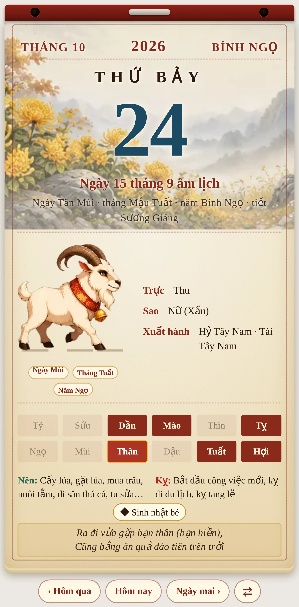
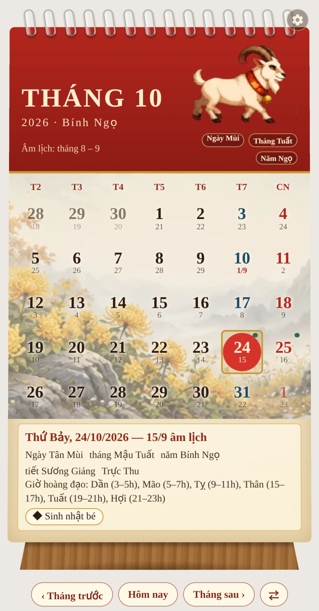
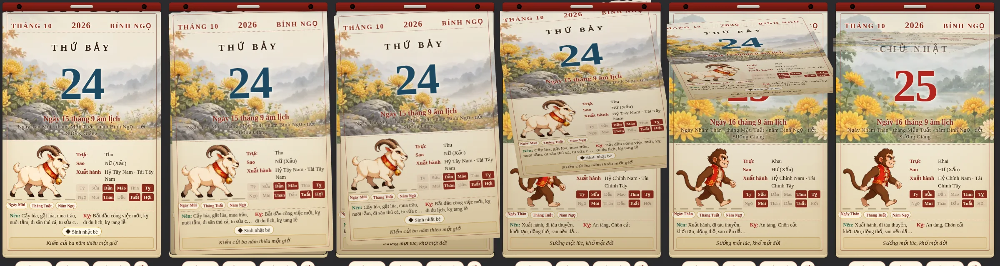
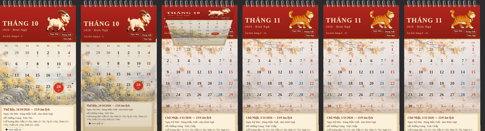
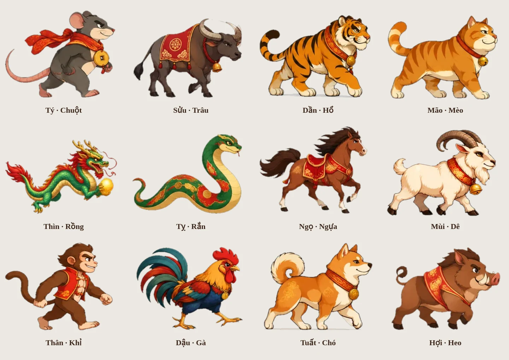

<p align="center"></p>

# Lịch Việt — Âm lịch & Sự kiện cho Home Assistant

Âm lịch Việt Nam, sự kiện giỗ/lễ/sinh nhật đếm ngược, thực thể **Lịch** của Home Assistant, và hai thẻ giao diện có con giáp động:

- **Lịch bloc xưa**: tờ lịch xé từng ngày (kéo hoặc vuốt lên để xé, xuống để dán lại; tự xé lúc nửa đêm).
- **Lịch để bàn**: lịch tháng gáy lò xo, lật tờ qua gáy khi đổi tháng, chạm một ngày để xem chi tiết.
- **Ảnh nền phong cảnh theo con giáp**: mỗi con giáp có 12 ảnh nền (12 tháng: đào Tết, đèn lồng, sen, phượng, trăng rằm, lúa chín, cúc, lá thu…) hợp với nơi ở của nó. Ảnh chỉ phủ phần đầu tờ bloc (đến đường gạch dưới dòng âm lịch) và khu lưới ngày của lịch để bàn, có lớp giấy mờ phủ lên để số ngày luôn rõ.
- **Con giáp theo ngày**: mỗi tờ hiện con giáp của *ngày* đó (kèm huy hiệu tháng, năm), đổi liên tục khi sang ngày khác. Mười con có chân bước bằng chân vẽ rời (xem dưới); rắn và rồng uốn sóng; đều là giống đực.

Kết hợp hai nguồn: lõi tính âm lịch, cảm biến sự kiện và các thẻ gốc của [khaisilk1910/am-lich-viet-nam](https://github.com/khaisilk1910/am-lich-viet-nam) (MIT), cùng ý tưởng sự kiện lặp hằng tháng và thực thể Lịch từ tích hợp `amlich` của smarthomeblack. Phần thêm: kiểu lặp hằng tháng, thực thể Lịch, nhập sự kiện cũ, hai thẻ mới.

## Hình ảnh

<p align="center">
  
  &nbsp;&nbsp;
  
</p>

Xé tờ (nhấc mép, lật bay lên để lộ tờ ngày hôm sau) và lật tháng qua gáy lò xo:

<p align="center"></p>
<p align="center"></p>

Con giáp có chân (chuột, trâu, hổ, mèo, ngựa, dê, khỉ, gà, chó, heo) bước bằng **chân vẽ rời**: thân là một ảnh không chân, mỗi chân là chín tư thế do mô hình tạo ảnh vẽ riêng (chân đặt trước, hạ xuống, đứng thẳng, đạp sau, nhấc lên, vung tới), ghép lớp trên Canvas 2D: chân xa (sẫm hơn, lệch pha) → thân (nhún nhẹ) → chân gần. Thú bốn chân bước so le một phần tư chu kỳ (sau gần, trước gần, sau xa, trước xa); khỉ và gà lệch nửa chu kỳ. Lúc nghỉ con vật đứng thẳng, bốn chân ở tư thế «đứng thẳng». Rắn và rồng không có chân nên dùng sprite uốn sóng (đẹp hơn bộ xương). Sprite cũng là phương án dự phòng nếu tải ảnh lỗi. Mỗi con có chân là một tấm ảnh ghép + một tệp cấu hình; thẻ tải sẵn con của ngày kế bên nên đổi lịch là có hình ngay:

<p align="center"></p>

## Cài đặt

1. HACS → ⋮ → **Kho tuỳ chỉnh** → dán `https://github.com/TriTue2011/calendar`, loại **Tích hợp**.
2. Tải về, khởi động lại Home Assistant.
3. **Cài đặt → Thiết bị & dịch vụ → Thêm tích hợp → Lịch Việt**, chọn *Tạo cảm biến âm lịch hằng ngày* (mục chính, có thực thể Lịch), rồi thêm từng sự kiện bằng cùng đường đó (*Thêm sự kiện âm lịch / dương lịch*).

Mã tích hợp là `lich_viet`, không đụng `amlich` hay `am_lich_viet_nam` nếu bạn đang dùng, nên cài song song được.

## Sự kiện

Mỗi sự kiện có ngày, tháng, năm gốc (tuỳ chọn, để tính «đã bao nhiêu năm») và **kiểu lặp**: *hằng năm* hoặc *hằng tháng* (Rằm, mùng 1 mỗi tháng). Quy ước tính ngày:

- Âm lịch hằng năm: tháng thường (không nhuận). Ngày 30 ở tháng thiếu 29 ngày lùi về ngày cuối tháng.
- Âm lịch hằng tháng: mọi tháng âm lịch, kể cả tháng nhuận.
- Dương lịch hằng năm: 29/2 năm không nhuận rơi vào 1/3. Hằng tháng: ngày 31 lùi về ngày cuối tháng.

Cảm biến đếm ngược (`sensor.<tên sự kiện>`) và thực thể Lịch (`calendar.su_kien`) dùng **cùng một mô-đun tính** (`su_kien.py`) nên không bao giờ lệch nhau.

### Nhập sự kiện từ `amlich` cũ

Gọi dịch vụ (quản trị viên) **Lịch Việt: Nhập sự kiện từ amlich cũ** (`lich_viet.nhap_tu_amlich_db`). Nó chỉ đọc `/config/events.db`, tạo sự kiện tương ứng, chạy lại không tạo trùng, và trả về số đã nhập / đã có / bị bỏ qua (sự kiện «một lần» chưa hỗ trợ nên bị bỏ qua kèm lý do).

Nếu báo «đường dẫn không nằm trong thư mục Home Assistant cho phép», thêm thư mục chứa tệp vào `homeassistant: allowlist_external_dirs` trong `configuration.yaml` (ví dụ `/config`) rồi khởi động lại.

## Thẻ giao diện

Thêm thẻ bằng giao diện (*Lịch bloc xưa*) hoặc YAML:

```yaml
type: custom:lich-bloc-xua-card
mode: bloc            # bloc | de_ban
con_giap: ngay        # ngay | thang | nam: con giáp lấy theo ngày, tháng hay năm
calendar_entity: calendar.su_kien   # tuỳ chọn: hiện sự kiện trên tờ lịch
hoat_hoa: true        # false: tắt mọi chuyển động
nut: true             # hàng nút Hôm qua / Hôm nay / Ngày mai và đổi chế độ
chay_giay: 6          # con vật bước trong bao nhiêu giây
nghi_giay: 25         # rồi đứng nghỉ bao nhiêu giây trước khi bước lại (0 = bước liên tục)
toc_do: 1             # nhân tốc độ bước (0.5 = chậm một nửa, 2 = nhanh gấp đôi)
cai_dat: true         # nút bánh răng ngay trên thẻ để chỉnh ba thông số trên (false = ẩn nút)
rong: 380             # chiều rộng tối đa (px)
```

Các thẻ gốc của khaisilk1910 (`lich-block-am-duong-viet-nam`, `su-kien-am-lich-card`, `lich-tuan-am-duong-viet-nam`, bóng bay) vẫn đi kèm và dùng như cũ.

Dịch vụ `lich_viet.convert_date` quy đổi dương ↔ âm và trả về thông tin ngày.

## Nhẹ cho dashboard

- Con vật có chân là **ảnh WebP vẽ rời** (khoảng 3 MB cho cả mười con, mỗi con một tấm 200–400 KB, giải mã khoảng 15–20 MB bộ nhớ khi hiện; cả tích hợp còn 278 tệp nên HACS tải nhanh), ghép bằng Canvas 2D; **một vòng requestAnimationFrame cho cả thẻ**, chỉ chạy khi con vật đang bước và thẻ đang hiện. Mỗi tờ chỉ tải con và ảnh nền của ngày đó (khoảng 20 KB mỗi ảnh nền). Rắn và rồng dùng sprite CSS (không vòng lặp JavaScript); sprite cũng là dự phòng cho các con kia.
- **Chỉnh ngay trên thẻ**: bấm nút bánh răng ở góc trên bên phải để kéo thanh trượt *Tốc độ bước*, *Bước trong*, *Nghỉ*; áp dụng tức thì và nhớ riêng cho từng thiết bị (điện thoại và bảng treo tường có thể khác nhau). «Mặc định» quay về giá trị trong YAML. Giá trị trong YAML (`toc_do`, `chay_giay`, `nghi_giay`) là mặc định cho mọi thiết bị.
- Con vật bước 6 giây rồi đứng nghỉ 25 giây (đổi bằng `chay_giay`, `nghi_giay`); lúc nghỉ con vật đứng thẳng, không vẽ lại; thẻ **tự dừng hẳn** khi ra khỏi màn hình hoặc tab bị ẩn; tôn trọng «giảm chuyển động» của hệ điều hành.
- Mức dùng CPU của bản chân vẽ rời **chưa đo** (số cũ ~2,8% là của bản sprite CSS).

## Giới hạn đã biết

- Chân vẽ rời mỗi chân chỉ có chín tư thế, chuyển tư thế đổi hẳn (không có ảnh trung gian), nên nhịp bước theo số tư thế; ở vài tư thế có thể còn mép nhỏ lệch ở chỗ chân gặp thân (nhất là chân sau xa của trâu và heo). Muốn vẽ lại một tư thế: tạo lại ảnh rồi đóng gói bằng `tools/chan_roi/dung_chan.py` (ra `custom_components/lich_viet/frontend/chan/<khoá>/atlas.webp` + `lich.json`).
- Con chuột bước bằng bốn chân (đã vẽ lại dáng bò so với bản sprite đứng thẳng); ở một tư thế nhấc chân trước xa, chân đó nằm trọn sau thân nên không thấy.
- Rắn, rồng: sprite 18 khung phát bằng CSS.
- Hình con giáp do mô hình AI vẽ (phong cách chibi Tết, giống đực); bản gốc nằm trong `custom_components/lich_viet/frontend/thu/`. Muốn đổi, thay tệp `<khoa>.webp` cùng quy cách (lưới 4×3 khung, nền trong suốt). Ảnh nền nằm ở `frontend/nen/<khoa>-<tháng>.webp` (12 ảnh mỗi con, tỉ lệ 2:1). Khoá: `ty suu dan mao thin ran ngo mui than ga cho heo`.
- Đã kiểm bằng 140 test (gồm test chạy trong Home Assistant giả lập: nhập sự kiện, thực thể Lịch, cảm biến, dịch vụ nhập; test cấu hình và ảnh của mười con chân vẽ rời; test bộ vẽ chạy bằng node) và Chrome không đầu cho hai thẻ (thẻ bloc chạy thật cả 12 con giáp, không lỗi console). **Chưa chạy trong Home Assistant thật của bạn**: màn hình cấu hình bằng tay (thêm sự kiện qua giao diện) và việc đăng ký thẻ trên dashboard thật chưa được thử.
- Âm lịch tính cho năm 1800–2199.

## Phát triển

```bash
pip install homeassistant pytest pillow
python -m pytest
```

## Giấy phép

MIT, xem [LICENSE](LICENSE).
